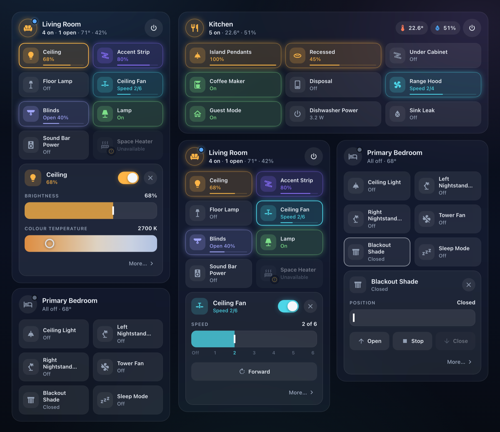

# Glasshouse Room Card

A room tile for Home Assistant that gives full control of every device in the room: lights, switches,
fans (including ceiling fans with speed steps), covers and blinds with position, input booleans and
read-only sensors. Part of the **Glasshouse** suite: refined dark glass, one accent per device type,
live numbers.



## Features

- **Header** with the room icon in a soft accent circle, the room name, and a live summary line
  (`3 on · 1 open · 71° · 42%`). Optional temperature and humidity chips (hidden on narrow cards, where
  the summary already carries them) and a motion dot that glows while motion is detected.
- **All off** button (`mdi:power`) that appears only when something is on. It turns off the room's
  lights, switches, fans and input booleans with one call per domain. Covers are left alone.
- **Device pills** with icon, name and live state: `68%`, `Off`, `Open 40%`, `Speed 2/6`. A thin level
  bar shows brightness, fan speed or cover position. Coloured lights glow in their own colour.
- **Gestures:** tap toggles (lights, switches, fans, input booleans, covers open/close; scripts and
  scenes run; buttons press; sensors open more-info). Hold opens the **control sheet**. Double-tap opens
  more-info.
- **Control sheet**, expanding inline below the pills:
  - Lights: brightness slider, plus colour temperature when the light supports it, and a power switch.
  - Fans: speed slider that follows `percentage_step` (with labelled steps up to 10 speeds),
    oscillate and direction toggles when supported, and a power switch.
  - Covers: position slider plus Open / Stop / Close.
  - Switches and input booleans: a large Off / On toggle.
  - Anything else: a large readout.
  - A **More…** link opens the standard more-info dialog.
- **Smooth sliders:** the value follows your finger locally, the service is called once on release, and
  the target value stays on screen until the device reports it.
- **Unavailable** devices are dimmed with a badge and are never toggled; holding one opens more-info.
- **Efficient:** on every Home Assistant update only the pills whose state object changed re-render.
- Sections view ready (`columns: 12`, `min_columns: 6`, `rows: auto`), phone width (360 px) up to wide
  desktop columns. Keyboard and screen-reader friendly. Respects `prefers-reduced-motion`.
- No dependencies, no build step: one JavaScript file.

## Installation

### HACS (custom repository)

1. HACS → ⋮ → **Custom repositories**.
2. Add `https://github.com/petergCA/glasshouse-room-card` with type **Dashboard**.
3. Install **Glasshouse Room Card**, then reload the browser.

### Manual

1. Copy `glasshouse-room-card.js` to `config/www/`.
2. Settings → Dashboards → ⋮ → **Resources** → add `/local/glasshouse-room-card.js` as a
   **JavaScript module**.

For the full look, pair it with the **Glasshouse** theme.

## Configuration

| Option | Type | Default | Description |
|---|---|---|---|
| `type` | string | **required** | `custom:glasshouse-room-card` |
| `name` | string | `Room` | Room name shown in the header. |
| `icon` | string | `mdi:home-outline` | Room icon. |
| `temperature` | entity | – | Sensor for the temperature chip and summary. |
| `humidity` | entity | – | Sensor for the humidity chip and summary. |
| `motion` | entity | – | Binary sensor; the dot on the room icon glows while it is `on`. |
| `columns` | number or `auto` | `auto` | Pill columns. `auto` = 2 on narrow cards, 3 from 520 px, 4 from 860 px. |
| `entities` | list | **required** | Devices in the room, as entity ids or objects (below). |

Entity object options:

| Option | Type | Description |
|---|---|---|
| `controls` | list | Extra on/off entities shown as toggle buttons in this device's control panel (e.g. `[{entity: switch.fan_horizontal_oscillation, name: Horizontal, icon: mdi:arrow-left-right}]`). For a fan this replaces the built-in Oscillate button. |
| `entity` | entity | **Required.** The entity id. |
| `name` | string | Display name (defaults to the friendly name). |
| `icon` | string | Icon (defaults to the entity's state icon). |
| `icon_off` | string | Icon to use while the device is off or closed. |

### Gestures

| Gesture | Action |
|---|---|
| Tap the icon | Toggle (light, switch, fan, input boolean, cover). Run script/scene, press button. |
| Tap the tile | Adjustable devices (dimmable/colour lights, fans with speeds, covers with position): a floating panel with brightness / colour temperature / colour, speed or position opens right where you tapped (tap outside or Esc to close). Everything else: same as tapping the icon; sensors open more-info. |
| Hold (500 ms) | Open / close the control sheet. Unavailable devices: more-info. |
| Double-tap | More-info. |
| Enter / Space | Toggle immediately. |
| Context-menu key, Shift+F10, right-click | Open the control sheet. |
| Escape | Close the control sheet. |

### Theming

Every design token can be overridden from a theme with a `glasshouse-*` variable, for example
`glasshouse-surface`, `glasshouse-radius`, `glasshouse-text-2`, `glasshouse-light`, `glasshouse-fan`,
`glasshouse-cover`, `glasshouse-switch`.

## Examples

Minimal:

```yaml
type: custom:glasshouse-room-card
name: Office
icon: mdi:desk
entities:
  - light.office_ceiling
  - switch.office_monitor
```

Full:

```yaml
type: custom:glasshouse-room-card
name: Living Room
icon: mdi:sofa
temperature: sensor.lounge_temperature
humidity: sensor.lounge_humidity
motion: binary_sensor.lounge_motion
columns: 2
entities:
  - light.ceiling
  - entity: light.accent_strip
    icon: mdi:led-strip-variant
  - entity: fan.ceiling_fan
    name: Ceiling Fan
    icon: mdi:ceiling-fan
  - entity: cover.blinds
  - entity: switch.lamp
    name: Lamp
    icon: mdi:lamp
    icon_off: mdi:lamp-outline
```

Bedroom with a sleep-mode helper:

```yaml
type: custom:glasshouse-room-card
name: Bedroom
icon: mdi:bed-outline
temperature: sensor.bedroom_temperature
entities:
  - light.bedroom_ceiling
  - fan.bedroom_tower_fan
  - cover.bedroom_shade
  - entity: input_boolean.sleep_mode
    icon: mdi:sleep
```

## Development

`test/harness.html` renders the card offline with stub `ha-card` / `ha-icon` / `ha-state-icon`
elements and a mock `hass` (`test/mock-hass.js`, generic demo data). Open it in a browser, or add
`?preview` for the composition used in `docs/preview.png`. `test/interaction.test.cjs` exercises taps,
holds, sliders, all-off and diffing under jsdom (`npm i jsdom` in a scratch directory, then run it from
there with node).

## License

MIT © Peter Gray
